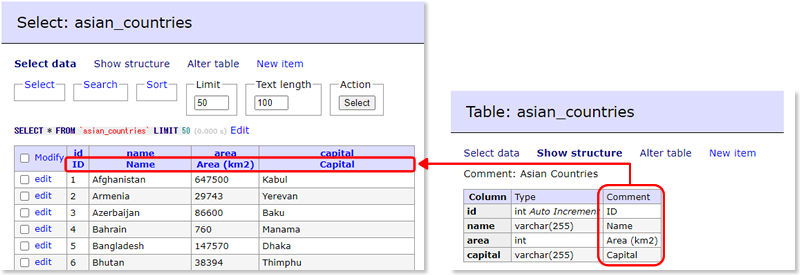
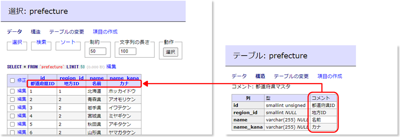

# adminer-show-column-comment

日本語の説明は下にあります。（Japanese explanation is the below.）

# Adminer Plugin - Show column comments in the result headers



Adminer plugin to show column comments in the headers of selected results.

This plugin is available in the page that displays the default result of single table.

## How to intall plugin

1. Just install Adminer PHP plugin.

## Comptible with Admin Neo

1. Create directory named `adminneo-plugins` and place `ShowColumnComment.php`
2. Create file `adminneo-plugins.php` and write the following.

```php
<?php

return [
    new \AdminNeo\ShowColumnComment(),
];
```

For more details, check [Admin Neo plugin usage page](https://www.adminneo.org/plugins#usage).

# Adminer Plugin - カラムコメントを選択結果のヘッダに表示する



SELECT結果のヘッダにカラムコメントを表示します。

このプラグインはデフォルトの単一SELECT結果のページでのみ有効です。

## インストール方法

1. Adminerのプラグイン設置方法に従ってインストールします。

## ## Admin Neo互換

1. `adminneo-plugins`ディレクトリーを作成して、`ShowColumnComment.php`を設置します。
2. `adminneo-plugins.php`を作成して以下を記述してください。

```php
<?php

return [
    new \AdminNeo\ShowColumnComment(),
];
```

詳細は[Admin Neo plugin usage page](https://www.adminneo.org/plugins#usage)を確認してください。

